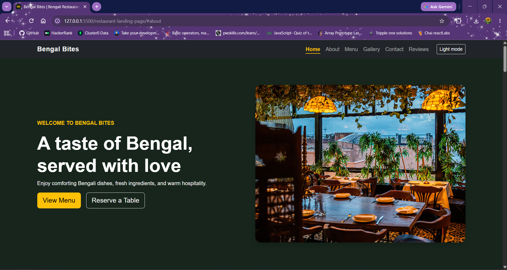
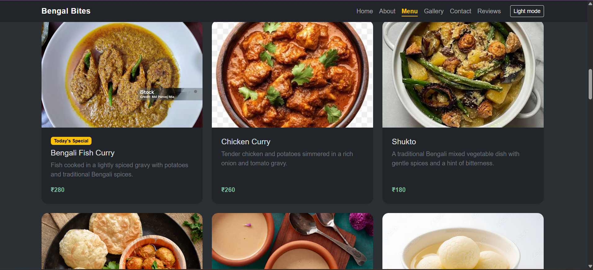
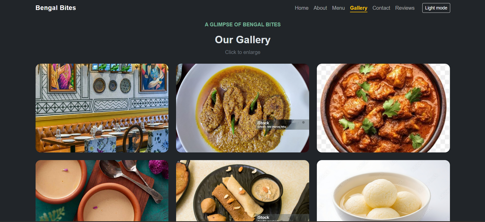
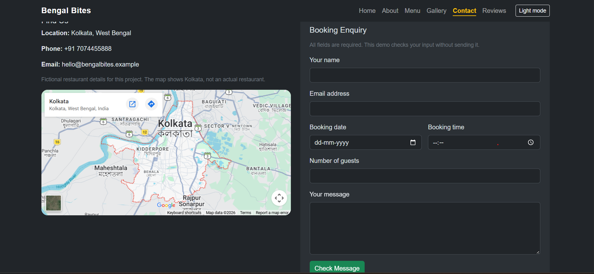
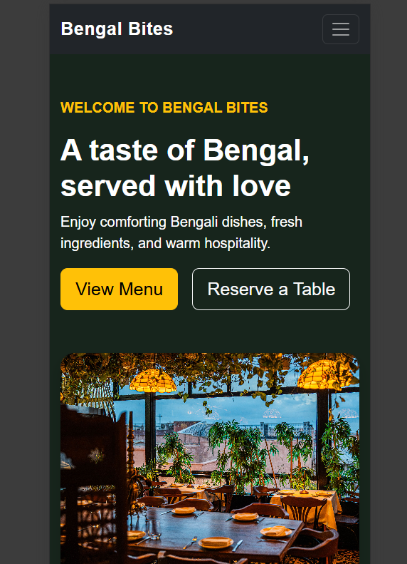

# Bengal Bites — Restaurant Landing Page

A responsive, single-page website for a fictional Bengali restaurant.

## Technologies

- HTML5
- CSS3
- JavaScript
- Bootstrap 5.3.3

## Features

- Sticky navigation with active section highlighting
- Compact mobile navigation
- Hero section with Menu and Contact links
- About section
- Six responsive menu cards
- Photo gallery with a Bootstrap modal
- Testimonials carousel
- Contact form with inline JavaScript validation
- Embedded Google Map
- Footer with sample opening hours and social icons
- Keyboard focus indicators and descriptive image text

## How to Run

1. Download or extract the complete project folder.
2. Open index.html in a web browser.
3. Keep an internet connection available for Bootstrap CDN
   files and the embedded Google Map.

No npm installation or build command is required.

## Main Files

- index.html — page structure and sections
- css/custom.css — custom styles and responsive adjustments
- js/main.js — gallery, form validation, and navbar behaviour
- assets/ — restaurant and food photos
- screenshots/ — project screenshots

## Contact Form

The form checks:

- Name: 2–60 characters after trimming
- Email: required, valid format, up to 120 characters
- Message: 10–1000 characters after trimming

This is a frontend demonstration. It does not send messages,
save enquiries, or confirm reservations.

## Demo Content

The restaurant, prices, reviews, and opening hours are sample
content. The map shows Kolkata rather than a verified restaurant
location. Social icons are placeholders.

## Screenshots

### Desktop Home

### Menu

### Gallery

### Form Validation

### Mobile Layout

## Image Credits

printerest.com, rawpixel.com, iStock, indiacuisine.net, weddingwire.in, AdobeStock, slurrp.com, 

## Author

Debalina Jana